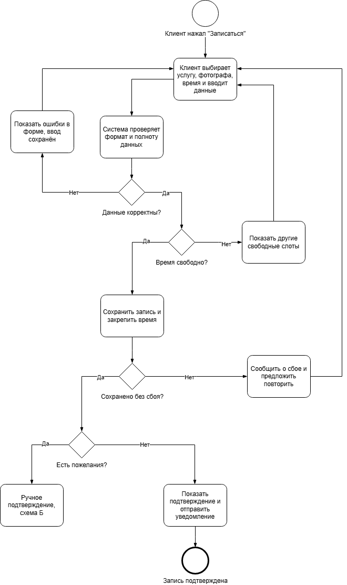
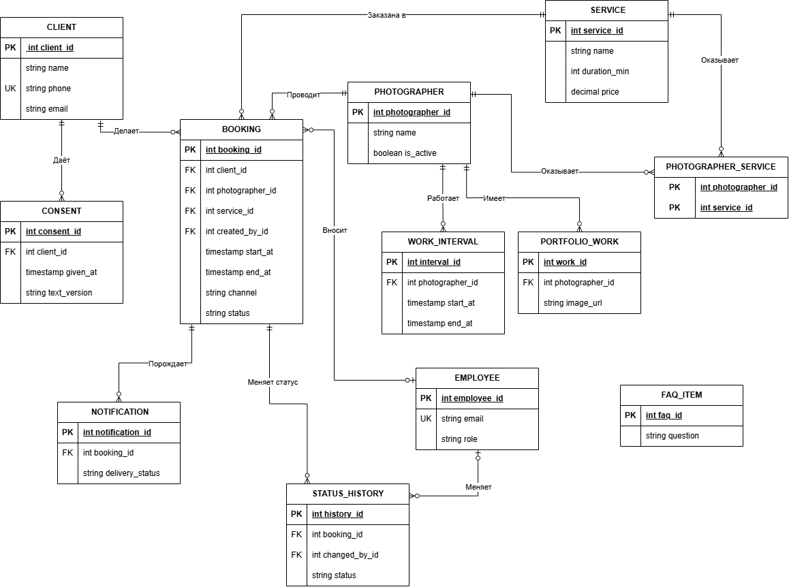

# Онлайн-запись для фотостудии: системный анализ

Учебный проект по системному анализу: от бизнес-целей до задач для разработки. 

## Проект на Confluence

Ссылка: https://saveliytsygankov.atlassian.net/wiki/x/1ACN

## Задача

Клиент может записаться в фотостудию только по телефону или лично. Цель MVP: не менее 50% записей через сайт, рост с 250 до 500 записей в месяц.

## Что внутри

| Артефакт | Где посмотреть |
| --- | --- |
| Концепция, границы, бизнес-цели, стейкхолдеры | [docs/01-concept.docx](docs/01-concept.docx) |
| 11 бизнес-процессов, BPMN основного процесса | [docs/02-business-processes.docx](docs/02-business-processes.docx), [diagrams/bpmn](diagrams/bpmn) |
| Диаграмма вариантов использования, сценарии UC-4 и UC-9 | [docs/03-use-cases.docx](docs/03-use-cases.docx) |
| 16 функциональных и 13 нефункциональных требований | [docs/04-requirements.docx](docs/04-requirements.docx) |
| Бэклог: 14 задач, 60 SP, 2 спринта | [docs/05-backlog.docx](docs/05-backlog.docx) |
| Открытые вопросы к заказчику | [docs/06-open-questions.docx](docs/06-open-questions.docx) |
| Модель данных, ER-диаграмма | [docs/07-data-model.docx](docs/07-data-model.docx) |
| Диаграмма последовательности, описание API | [docs/08-sequence-and-api.docx](docs/08-sequence-and-api.docx) |
| Схема БД, тестовые данные, запросы, тест двойной записи | [database](database) |
| Контракт API (OpenAPI) и коллекция Postman | [api](api) |
| Матрица трассируемости | [docs/traceability.docx](docs/traceability.docx) |

## Как выглядит процесс записи

## Модель данных

## Ключевые решения

- Проверка и закрепление времени выполняются одной транзакцией, чтобы два клиента не заняли один слот (FR-7). В базе это ограничение `bookings_no_overlap`.
- Свободное время не хранится, а вычисляется из графика работы и записей (запрос Q1 в `database/03_queries.sql`).
- Отмена записи по секретной ссылке, потому что клиент записывается без регистрации.
- Повторный запрос на создание записи не создаёт дубль благодаря `Idempotency-Key`.
- Клиента не удаляют, а обезличивают: записи остаются, и отчёты по бизнес-целям не меняются.

## Как запустить базу

1. Создать базу в PostgreSQL 14 или выше.
2. Выполнить `database/01_schema.sql`, затем `database/02_seed.sql`.
3. Запросы лежат в `database/03_queries.sql`, проверка двойной записи в `database/04_double_booking_test.sql`.

Подробности: [database/README.md](database/README.md).

## Трассируемость

Бизнес-цель → вариант использования → сценарий → требования → данные → API → задачи. Матрица: [docs/traceability.docx](docs/traceability.docx).

## Об авторе 

Автор: Цыганков Савелий, системный аналитик.

